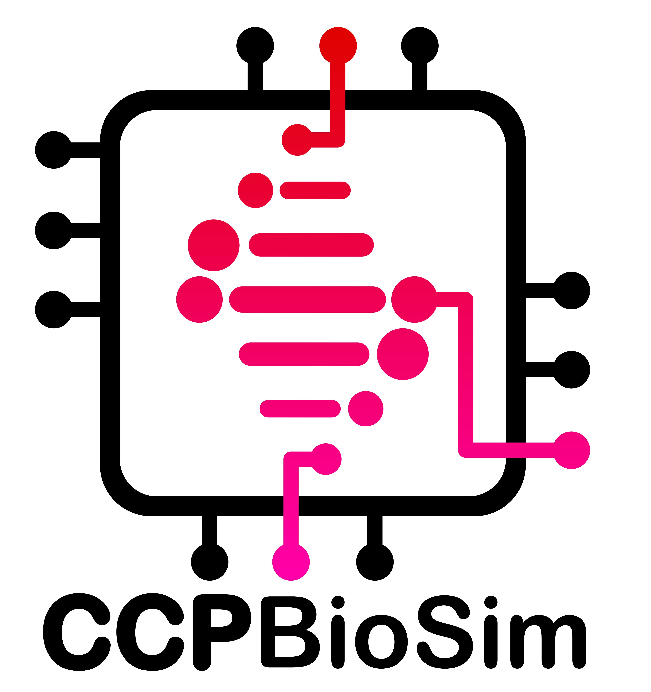

:html_theme.sidebar_secondary.remove:

biosim-extractor
================

.. ccpbiosim-hero::
   :logo-light: _static/logos/biosim-extractor-logo-dark.png
   :logo-dark: _static/logos/biosim-extractor-logo-light.png
   :logo-alt: biosim-extractor logo
   :tagline: biosim-extractor
   :button: installation | Get started
   :github: CCPBioSim/biosim-extractor

   A toolkit for extracting standardised metadata from molecular dynamics (MD) simulations

BioSim Extractor provides tools to parse, extract, and standardise metadata from
MD simulation outputs (AMBER, GROMACS, etc.), and validate against
`biosim-schema <https://github.com/CCPBioSim/biosim-schema>`_.

Quick start
-----------

.. tab-set::

   .. tab-item:: pip

      .. code-block:: bash

         pip install biosim-extractor

   .. tab-item:: Conda

      .. code-block:: bash

         conda install -c conda-forge -c ccpbiosim biosim-extractor

Features
--------

- Parse log files from multiple MD engines
- Extract topology and trajectory metadata
- Standardise units and schema
- Validate metadata against `biosim-schema <https://github.com/CCPBioSim/biosim-schema>`_

Explore the documentation
-------------------------

.. grid:: 1 2 2 2
   :gutter: 3

   .. grid-item-card:: 📦 Installation
      :link: installation
      :link-type: doc

      Install biosim-extractor with pip or Conda, or from source.

   .. grid-item-card:: 🚀 Usage
      :link: usage
      :link-type: doc

      Extract and validate metadata from the command line.

   .. grid-item-card:: 📖 API
      :link: reference/biosim_extractor/index
      :link-type: doc

      Reference for the biosim-extractor package.

   .. grid-item-card:: 👩‍💻 Contributing
      :link: contributing
      :link-type: doc

      Setting up a development environment and contributing.

.. toctree::
   :maxdepth: 2
   :hidden:

   Installation <installation>
   Usage <usage>
   API <reference/biosim_extractor/index>
   Contributing <contributing>

Funding
-------

Contributors to biosim-extractor were supported by

